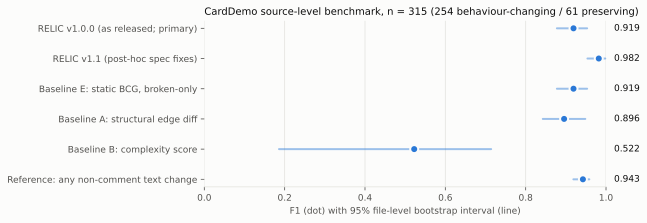

# RELIC

### Execution-Grounded Behavioral Analysis for Legacy Software Modernization

Legacy modernization can preserve every structural dependency while silently changing the behavior those dependencies are meant to protect. **RELIC** makes implicit behavioral obligations explicit as Behavioral Contract Graphs, compares them across versions using confidence-delta differencing, and uses execution evidence to distinguish supported, conflicting, and unobserved behavior.

---


---

## Why this problem matters

JCL job streams encode behavioral obligations that are never written down as specifications: step ordering constraints, dataset availability dependencies, return-code propagation guards. When a system is migrated to cloud-native orchestration or translated to Java, these obligations become invisible. The result is *semantic behavioral regression* — the modernized system runs without crashing but violates a contract the original JCL silently enforced.

Structural dependency analysis can tell you what depends on what. It cannot tell you whether the behavioral obligation is preserved.

---

## The key idea

Consider a JCL control-flow mutation:


The structural dependency graph is **identical** in both versions. The same steps reference the same programs and datasets. Structural Baseline A misses this. RELIC represents a `CONTROL_FLOW` contract with `static_support=1.00`; the mutation lowers it to `0.70`. BCGDiff detects `Δ=0.30 > threshold` and flags the risk.

This *confidence-delta detection* — catching contracts that are weakened rather than removed — is the core architectural contribution.

---

## Results

On the AWS CardDemo mutation benchmark (104 evaluated mutations, 144 semantics-preserving negatives):



| Method | F1 |
|---|---:|
| **RELIC** | **1.000** |
| Static BCG (no confidence-delta) | 0.960 |
| Structural dependency | 0.900 |
| Dependency + LLM† | 0.109 |
| LLM-only† | 0.038 |
| Complexity metrics | 0.000 |

RELIC detected 104/104 evaluated contract-violating mutations and produced zero false positives across 144 semantics-preserving mutations.

†  LLM baselines were run with blinded prompts but experienced substantial API failures (245/248 and 241/248 calls errored); the reported numbers are lower bounds. See [docs/experiments.md](docs/experiments.md#e_llm--llm-baseline-evaluation).

Dynamic evidence: 56/61 contracts supported by available traces (91.8%). Evaluation used 2 real GnuCOBOL traces and 38 JCL-simulated traces — not z/OS execution.

**These are benchmark-specific results on a single demonstration application. They should not be interpreted as production-wide accuracy.**

---

## Quickstart

```bash
git clone https://github.com/ManasSakthivel/RELIC.git
cd RELIC

pip install poetry
poetry install

make test               # 305 tests

make reproduce-paper1   # all deterministic results
```

Results written to `results/rq1/`, `results/rq2/`, `results/rq3/`.

LLM baselines (optional):
```bash
export GROQ_API_KEY="your-key"
python3.11 scripts/run_llm_baselines.py
```

No local GnuCOBOL required for deterministic experiments. For trace generation, see [docs/reproducibility.md](docs/reproducibility.md).

---

## Repository

```
RELIC/
├── src/legacy_contract/     # source — parsers, IR, BCG, reconciliation, risk
├── baselines/               # baselines A–E
├── tests/                   # 305 tests (unit · integration · scientific integrity)
├── scripts/                 # reproduction scripts
├── datasets/                # CardDemo (Apache 2.0) + public COBOL
├── traces/                  # execution traces (GnuCOBOL + JCL simulation)
├── benchmark/               # ground truth annotations
├── experiments/             # frozen experiment configurations
├── results/                 # frozen results (JSON + CSV)
├── paper/                   # manuscript, tables, figures
├── docs/                    # architecture, methodology, experiments, limitations
└── examples/quickstart/     # minimal end-to-end example
```

The internal Python package is `legacy_contract` (`src/legacy_contract/`).

---

## Documentation

| Document | Contents |
|---|---|
| [Architecture](docs/architecture.md) | System components, data flow, BCG model |
| [Methodology](docs/methodology.md) | RQs, hypotheses, baselines, experimental design |
| [Experiments](docs/experiments.md) | Per-experiment configuration and methodology |
| [Reproduction](docs/reproducibility.md) | Step-by-step reproduction guide |
| [Limitations](docs/limitations.md) | Honest scope and limitations |
| [Results](results/FINAL_RESULTS.md) | Full results with per-operator breakdown |

---

## Dataset

**AWS Mainframe Modernization CardDemo** — 161 legacy artifacts: 55 JCL, 44 COBOL, 62 copybooks.  
Source: [aws-samples/aws-mainframe-modernization-carddemo](https://github.com/aws-samples/aws-mainframe-modernization-carddemo) (Apache 2.0).  
See [datasets/carddemo/README.md](datasets/carddemo/README.md) for full provenance.

---

## Limitations

- **Single dataset**: all results are on CardDemo, a demonstration application of modest scale
- **GnuCOBOL, not z/OS**: dynamic evidence is from GnuCOBOL 3.2.0 on Linux/macOS; 38/40 traces are JCL-ordering simulations
- **TEMPORAL oracle only**: RQ1 independent evaluation covers TEMPORAL contracts; RESOURCE and CONTROL_FLOW require human annotation
- **LLM results are lower bounds**: substantial API failure rates during the evaluated runs
- **FPR=0 is a closed-set property**: the negative benchmark uses semantics-preserving operators by construction

Full detail: [docs/limitations.md](docs/limitations.md)

---

## Paper

Manuscript: [`paper/paper.tex`](paper/paper.tex) (ACM sigconf, double-blind, under review)  
Figures: [`paper/figures/`](paper/figures/) — 6 figures  
Tables: [`paper/tables/`](paper/tables/) — 10 tables  
References: [`paper/references.bib`](paper/references.bib)

---

## Citation

```bibtex
@misc{relic2025,
  title  = {RELIC: Execution-Grounded Behavioral Analysis
            for Legacy Software Modernization},
  author = {Manas Sakthivel},
  year   = {2025},
  url    = {https://github.com/ManasSakthivel/RELIC},
  note   = {Manuscript under review}
}
```

See [`CITATION.cff`](CITATION.cff) for machine-readable metadata.

---

## License

Code: Apache 2.0 — see [`LICENSE`](LICENSE).  
CardDemo dataset: Apache 2.0, copyright Amazon.com, Inc. — see [`datasets/carddemo/README.md`](datasets/carddemo/README.md).
