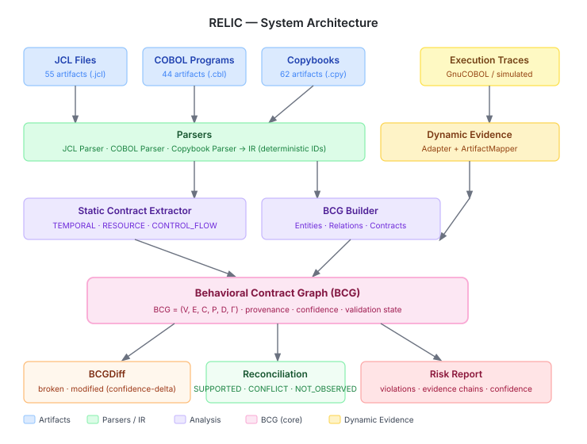

# RELIC

Behavioral contract analysis for JCL batch modernization — with an independent,
execution-semantics evaluation.

> **Status (October 2026).** The evaluation in this repository was rebuilt from
> scratch during a research remediation. Earlier versions' withdrawn F1 = 1.000
> came from a circular mutation benchmark.
> What changed and why: [docs/remediation/PRE_REMEDIATION_AUDIT.md](docs/remediation/PRE_REMEDIATION_AUDIT.md)
> and [docs/FINAL_RESEARCH_READINESS_REPORT.md](docs/FINAL_RESEARCH_READINESS_REPORT.md).

---

## 1. What RELIC is and the problem it addresses

Mainframe batch systems encode behavioral rules in JCL that are never written down
as specifications: steps run in a fixed order, a later step reads a dataset an
earlier step creates, and `COND=` return-code tests decide whether a step runs.
When a job stream is re-expressed for another platform (a workflow engine, a
scheduler DAG, a rewritten job), these rules have to be reimplemented by hand, and
losing one rarely causes a crash — the job just behaves differently.

RELIC extracts these implicit rules from JCL as explicit **behavioral contracts**
and checks whether a changed version of the job still satisfies them.

## 2. Research contribution (what is claimed)

1. A **Behavioral Contract Graph** (BCG) for JCL: steps, programs and datasets as
   entities; three contract types — TEMPORAL (step A precedes step B), RESOURCE
   (A produces a dataset before B consumes it), CONTROL_FLOW (B must not run when
   A's return code satisfies a COND test) — each with provenance.
2. **Contract differencing** between an original and a changed job, reporting
   broken and weakened contracts with an explanation chain.
3. An **evaluation methodology** for this class of tool: source-level mutation of
   real JCL, labelled by an independent JCL execution-semantics oracle, with full
   accounting of every candidate mutant. This is new in this version and is the
   part of the repository most directly reusable by other researchers.

## 3. How it works

```
original JCL ─┐                                   ┌─ broken / weakened contracts
              ├─ JCL parser → IR → contract extractor → BCG ─┤
changed JCL  ─┘        (TEMPORAL, RESOURCE, CONTROL_FLOW)    └─ = risk report
```

`src/legacy_contract/` — parser (`parsers/jcl_parser.py`), extractor
(`static_analysis/extractor.py`), BCG and diff (`bcg/model.py`), risk detector
(`risk/detector.py`). The repository also contains a dynamic-evidence
reconciliation component; it has not been validated with real execution evidence
(see Limitations).

<p align="center">
  
</p>

## 4. What was evaluated

* **Subjects (multi-subject evaluation, not third-party external validation):**
  three public JCL corpora by different authors —
  [AWS CardDemo](https://github.com/aws-samples/aws-mainframe-modernization-carddemo)
  (primary; 55 job files), the
  [Open Mainframe Project COBOL Programming Course](https://github.com/openmainframeproject/cobol-programming-course)
  (37 job files) and IBM's [CICS GenApp](https://github.com/cicsdev/cics-genapp)
  (29 job files). All are demonstration or teaching code, not production systems.
* **Mutants:** ten source-level operators (step reordering, job splitting, producer
  deletion, producer-side dataset rename, consumer-before-producer, COND removal,
  COND threshold change, IF-guard removal, and two refactorings expected to be
  harmless), applied at every applicable site. [Details](docs/evaluation/BENCHMARK.md).
* **Ground truth:** `jcl_oracle/`, a simulator of JCL execution semantics
  (COND, IF/THEN/ELSE, abends, allocation and dispositions, IDCAMS, utilities,
  procedures, COBOL file I/O) that compares the two versions under return-code
  and abend scenarios. It shares no code with RELIC and never sees the mutation
  operator. [Specification and independence argument](docs/evaluation/ORACLE_SPECIFICATION.md).
* **Detectors (all blind to the mutation):** RELIC v1.0.0 as released (primary),
  RELIC v1.1 (fixes made after the audit — not blind), static BCG diff (Baseline E),
  structural edge diff (Baseline A), complexity score (Baseline B), and a trivial
  reference that flags any non-comment text change.

## 5. Results

<!-- BEGIN GENERATED:results-summary -->
- **Benchmark:** 656 candidate source-level mutants over 3 subject systems (566 evaluable, 86.3%); ground truth from an independent JCL execution-semantics oracle.
- **Primary result (CardDemo, RELIC v1.0.0 as released):** precision 1.000, recall 0.850, F1 0.919 (95% CI [0.88, 0.95]; TP 216, FP 0, FN 38, TN 61; n = 315).
- **RELIC v1.1** (spec-conformance fixes made *after* seeing these results): F1 0.982 on CardDemo.
- **Reference detector** that flags any non-comment text change: F1 0.943 (specificity 0.492); RELIC v1.0.0 − reference F1 difference 95% CI [-0.07, 0.02].
- **Structural baseline A:** F1 0.896.
- **All three subjects pooled:** RELIC v1.0.0 F1 0.905 (n = 566).
- **LLM baselines** (`openai/gpt-oss-120b`; scored only where both LLM baselines answered — 39 of 566 evaluable mutants (6.9%), all subjects): LLM-only F1 0.898 (P 0.957, R 0.846, specificity 0.923); dependency + LLM F1 0.980 (P 1.000, R 0.962, specificity 1.000); RELIC v1.0.0 on the same mutants F1 0.894 (RELIC v1.0.0 − LLM-only F1 difference 95% CI [-0.30, 0.15]; − dependency + LLM [-0.30, 0.00]). Coverage is limited by the provider quota of the API key used; the answered mutants are the first ones of a seeded random order, i.e. a random subsample. The earlier F1 0.0377 / 0.1091 figures were artifacts of rate-limited calls scored as negatives and are withdrawn.
<!-- END GENERATED:results-summary -->

<!-- BEGIN GENERATED:table-main-carddemo -->
Population: AWS CardDemo, EVALUABLE mutants (n = 315: 254 behaviour-changing, 61 behaviour-preserving; 31 files)

| Detector | TP | FP | FN | TN | Precision | Recall | F1 | F1 95% CI (file bootstrap) | Specificity |
|---|---:|---:|---:|---:|---:|---:|---:|---|---:|
| **RELIC v1.0.0 (as released; primary)** | 216 | 0 | 38 | 61 | 1.000 | 0.850 | 0.919 | [0.88, 0.95] | 1.000 |
| RELIC v1.1 (post-hoc spec fixes) | 245 | 0 | 9 | 61 | 1.000 | 0.965 | 0.982 | [0.95, 1.00] | 1.000 |
| Baseline E: static BCG, broken-only | 216 | 0 | 38 | 61 | 1.000 | 0.850 | 0.919 | [0.88, 0.95] | 1.000 |
| Baseline A: structural edge diff | 206 | 0 | 48 | 61 | 1.000 | 0.811 | 0.896 | [0.84, 0.95] | 1.000 |
| Baseline B: complexity score | 93 | 9 | 161 | 52 | 0.912 | 0.366 | 0.522 | [0.19, 0.71] | 0.853 |
| Reference: any non-comment text change | 254 | 31 | 0 | 30 | 0.891 | 1.000 | 0.943 | [0.92, 0.96] | 0.492 |
<!-- END GENERATED:table-main-carddemo -->

How to read this honestly:

* **Recall is the discriminating dimension.** Most fault mutants really change
  behaviour, so a detector that flags *every* edit already scores high F1. RELIC's
  advantage over that reference is specificity on harmless edits; on CardDemo its
  F1 is not higher than the reference.
* **Precision of 1.000 depends on the oracle's abend semantics.** Under JCL rules,
  reordering any two steps changes which steps run when one of them abends, so the
  oracle labels every reorder as behaviour-changing. If only normal completion is
  considered observable, RELIC flags some harmless reorders
  ([sensitivity analysis](docs/evaluation/RESULTS.md#sensitivity-analyses--carddemo)).
* **LLM baselines are competitive.** On the random subsample both LLM baselines
  answered (limited by the API quota), the LLM given both job versions, with or
  without a dependency summary, is at least as accurate as RELIC v1.0.0. The
  subsample is small and the intervals are wide.
* **Where RELIC v1.0.0 misses:** COND threshold changes (its diff ignored the
  threshold), producer-side renames (a continuation-line parser bug hid most
  dataset dispositions), procedure-internal steps and same-named steps.

All tables, per-subject results, per-operator results, contract-recovery results
and sensitivity analyses: [docs/evaluation/RESULTS.md](docs/evaluation/RESULTS.md).
Every number on this page is generated from `results/final/metrics.json`.

<p align="center">
  
</p>

## 6. Baselines

Structural (A) and complexity (B) baselines and the static BCG baseline (E) are
evaluated. Two defects of the old baselines were corrected (Baseline B was given
the mutation's location and could never fire).

The LLM baselines were re-implemented and run with Groq `openai/gpt-oss-120b`.
Baseline C sees the original and modified JCL. Baseline D sees the same plus an
extracted dependency summary. Neither prompt contains the operator, the site or
the label. Failed or unparseable calls are excluded, never scored, and every
detector is compared with the LLMs on the common set of mutants both LLM
baselines answered. Results and coverage are in the summary above and in
[RESULTS.md](docs/evaluation/RESULTS.md#llm-baselines-common-population). The
previously reported LLM F1 values (0.0377 / 0.1091) are withdrawn: 245/248 and
241/248 calls had failed with HTTP 429 and were scored as "no regression", and
the prompt never contained the JCL. [Protocol](docs/evaluation/BASELINES.md).

## 7. Limitations

* **Small, non-production subjects.** Three demonstration/teaching corpora;
  CardDemo dominates the evaluation. No production JCL was available.
* **Oracle validity.** The oracle is a model of JCL semantics written for this
  evaluation; it has not been checked against real z/OS execution or by an
  independent mainframe engineer.
* **Single-file analysis.** Cross-job dependencies (most of CardDemo's datasets
  flow between jobs) are out of scope.
* **Synthetic faults.** Mutants simulate documented failure classes; they are not
  real migration defects.
* **No third-party external validation.** All three subjects were selected and
  evaluated by the RELIC authors with an oracle they wrote.
* **Contract coverage.** Only TEMPORAL, RESOURCE and CONTROL_FLOW are implemented
  and evaluated; DATA, STATE and ERROR contracts are future work.
* **LLM comparison** uses one model, one prompt and one sample per mutant.
* **No validated dynamic evidence** (the withdrawn legacy "dynamic validation"
  rate used traces derived from RELIC's own parser).
* RELIC v1.1 results are post hoc.

Full list with evidence and next steps: [docs/limitations.md](docs/limitations.md).

## 8. Reproducing

Requires Python ≥ 3.11 (macOS or Linux). No mainframe, GnuCOBOL or API key needed.

```bash
git clone https://github.com/ManasSakthivel/RELIC.git && cd RELIC
make setup        # .venv + pinned dependencies (requirements.lock)
make test         # full test suite
make reproduce    # mutants → oracle → detectors → metrics → tables → figures → docs (5–25 min)
make check        # verifies every reported number against the raw records
```

Outputs: `results/final/` (raw records, manifest, metrics, tables),
`paper/generated/` (LaTeX tables), `figures/final/`. Details:
[docs/reproducibility.md](docs/reproducibility.md).

## 9. Repository layout

```
src/legacy_contract/  RELIC (parser, extractor, BCG, diff, risk detector, reconciliation)
jcl_oracle/           independent JCL execution-semantics oracle (ground truth)
relic_eval/           authoritative evaluation pipeline (mutants, detectors, metrics, reports)
baselines/            baselines A, B, E (+ legacy LLM baselines C, D)
datasets/             CardDemo, OMP COBOL course, GenApp (with licenses / provenance)
results/final/        current results;  results/legacy/, results/rq*/  pre-remediation results
docs/evaluation/      benchmark, oracle, baselines, results
docs/remediation/     audit, bibliography verification
paper/                manuscript (paper.md / paper.tex) and generated tables
tests/                unit, integration, oracle, evaluation and regression tests
```

## Citation

See [CITATION.cff](CITATION.cff). Manuscript draft: [paper/paper.md](paper/paper.md) (not peer reviewed).

## License

Apache-2.0. Subject systems keep their own licenses: CardDemo (Apache-2.0),
OMP COBOL Programming Course (CC-BY-4.0 / Apache-2.0), GenApp (EPL-2.0, see
`datasets/genapp/`).
