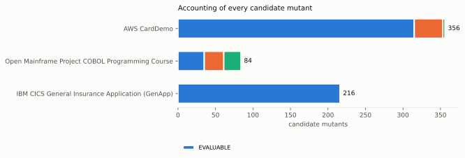
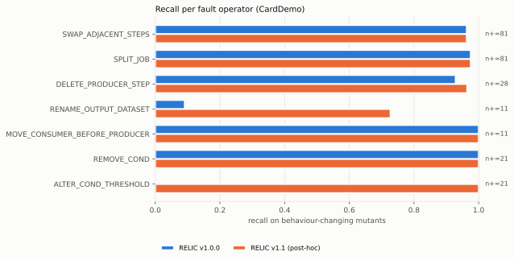

# Results (generated)

Every table on this page is written by `python -m relic_eval.pipeline` from
`results/final/metrics.json`; `make check` fails if any of them differs from a
fresh rendering. Do not edit the generated blocks by hand.

Primary result: RELIC v1.0.0 (as released) on the CardDemo subject. RELIC v1.1
contains fixes made after the audit and after first benchmark runs, so it is not
a blind result. Methodology: [BENCHMARK.md](BENCHMARK.md),
[ORACLE_SPECIFICATION.md](ORACLE_SPECIFICATION.md), [BASELINES.md](BASELINES.md).

## Summary

<!-- BEGIN GENERATED:results-summary -->
- **Benchmark:** 656 candidate source-level mutants over 3 subject systems (566 evaluable, 86.3%); ground truth from an independent JCL execution-semantics oracle.
- **Primary result (CardDemo, RELIC v1.0.0 as released):** precision 1.000, recall 0.850, F1 0.919 (95% CI [0.88, 0.95]; TP 216, FP 0, FN 38, TN 61; n = 315).
- **RELIC v1.1** (spec-conformance fixes made *after* seeing these results): F1 0.982 on CardDemo.
- **Reference detector** that flags any non-comment text change: F1 0.943 (specificity 0.492); RELIC v1.0.0 − reference F1 difference 95% CI [-0.07, 0.02].
- **Structural baseline A:** F1 0.896.
- **All three subjects pooled:** RELIC v1.0.0 F1 0.905 (n = 566).
- **LLM baselines** (`openai/gpt-oss-120b`; scored only where both LLM baselines answered — 39 of 566 evaluable mutants (6.9%), all subjects): LLM-only F1 0.898 (P 0.957, R 0.846, specificity 0.923); dependency + LLM F1 0.980 (P 1.000, R 0.962, specificity 1.000); RELIC v1.0.0 on the same mutants F1 0.894 (RELIC v1.0.0 − LLM-only F1 difference 95% CI [-0.30, 0.15]; − dependency + LLM [-0.30, 0.00]). Coverage is limited by the provider quota of the API key used; the answered mutants are the first ones of a seeded random order, i.e. a random subsample. The earlier F1 0.0377 / 0.1091 figures were artifacts of rate-limited calls scored as negatives and are withdrawn.
<!-- END GENERATED:results-summary -->

## Mutation accounting

<!-- BEGIN GENERATED:table-accounting -->
| Subject | Candidates | EVALUABLE | OUT_OF_SCOPE | INVALID_MUTATION | INFRASTRUCTURE_FAILURE | OTHER | % evaluable |
|---|---:|---:|---:|---:|---:|---:|---:|
| AWS CardDemo | 356 | 315 | 38 | 3 | 0 | 0 | 88.5% |
| Open Mainframe Project COBOL Programming Course | 84 | 35 | 26 | 23 | 0 | 0 | 41.7% |
| IBM CICS General Insurance Application (GenApp) | 216 | 216 | 0 | 0 | 0 | 0 | 100.0% |
| **All subjects** | 656 | 566 | 64 | 26 | 0 | 0 | 86.3% |
<!-- END GENERATED:table-accounting -->

Reasons for every non-evaluable candidate:

<!-- BEGIN GENERATED:table-reasons -->
| Status / reason | CardDemo | OMP course | GenApp | All |
|---|---:|---:|---:|---:|
| INVALID_MUTATION | renamed DSN exceeds JCL length limits | 3 | 0 | 0 | 3 |
| INVALID_MUTATION | split point inside IF/THEN/ELSE | 0 | 23 | 0 | 23 |
| OUT_OF_SCOPE | IF/THEN/ELSE/ENDIF is outside RELIC's declared parser scope (jcl_parser.py: 'noted but not deeply parsed') | 0 | 23 | 0 | 23 |
| OUT_OF_SCOPE | no consumer of this dataset inside the analysed JCL file (cross-file effect only) | 38 | 3 | 0 | 41 |
<!-- END GENERATED:table-reasons -->

## Detection results — CardDemo (primary)

<!-- BEGIN GENERATED:table-main-carddemo -->
Population: AWS CardDemo, EVALUABLE mutants (n = 315: 254 behaviour-changing, 61 behaviour-preserving; 31 files)

| Detector | TP | FP | FN | TN | Precision | Recall | F1 | F1 95% CI (file bootstrap) | Specificity |
|---|---:|---:|---:|---:|---:|---:|---:|---|---:|
| **RELIC v1.0.0 (as released; primary)** | 216 | 0 | 38 | 61 | 1.000 | 0.850 | 0.919 | [0.88, 0.95] | 1.000 |
| RELIC v1.1 (post-hoc spec fixes) | 245 | 0 | 9 | 61 | 1.000 | 0.965 | 0.982 | [0.95, 1.00] | 1.000 |
| Baseline E: static BCG, broken-only | 216 | 0 | 38 | 61 | 1.000 | 0.850 | 0.919 | [0.88, 0.95] | 1.000 |
| Baseline A: structural edge diff | 206 | 0 | 48 | 61 | 1.000 | 0.811 | 0.896 | [0.84, 0.95] | 1.000 |
| Baseline B: complexity score | 93 | 9 | 161 | 52 | 0.912 | 0.366 | 0.522 | [0.19, 0.71] | 0.853 |
| Reference: any non-comment text change | 254 | 31 | 0 | 30 | 0.891 | 1.000 | 0.943 | [0.92, 0.96] | 0.492 |
<!-- END GENERATED:table-main-carddemo -->

## Detection results — all subjects

<!-- BEGIN GENERATED:table-subjects -->
| Detector | AWS CardDemo | Open Mainframe Project COBOL Programming Course | IBM CICS General Insurance Application (GenApp) | All subjects |
|---|---:|---:|---:|---:|
| n (pos/neg) | 315 (254/61) | 35 (10/25) | 216 (196/20) | 566 (460/106) |
| RELIC v1.0.0 (as released; primary) | F1 0.919 (P 1.000, R 0.850) | F1 0.947 (P 1.000, R 0.900) | F1 0.883 (P 1.000, R 0.791) | F1 0.905 (P 1.000, R 0.826) |
| RELIC v1.1 (post-hoc spec fixes) | F1 0.982 (P 1.000, R 0.965) | F1 1.000 (P 1.000, R 1.000) | F1 0.905 (P 1.000, R 0.827) | F1 0.951 (P 1.000, R 0.906) |
| Baseline E: static BCG, broken-only | F1 0.919 (P 1.000, R 0.850) | F1 0.947 (P 1.000, R 0.900) | F1 0.883 (P 1.000, R 0.791) | F1 0.905 (P 1.000, R 0.826) |
| Baseline A: structural edge diff | F1 0.896 (P 1.000, R 0.811) | F1 0.889 (P 1.000, R 0.800) | F1 0.880 (P 1.000, R 0.786) | F1 0.889 (P 1.000, R 0.800) |
| Baseline B: complexity score | F1 0.522 (P 0.912, R 0.366) | F1 0.439 (P 0.290, R 0.900) | F1 0.465 (P 0.968, R 0.306) | F1 0.495 (P 0.831, R 0.352) |
| Reference: any non-comment text change | F1 0.943 (P 0.891, R 1.000) | F1 1.000 (P 1.000, R 1.000) | F1 0.975 (P 0.952, R 1.000) | F1 0.957 (P 0.918, R 1.000) |
<!-- END GENERATED:table-subjects -->

<!-- BEGIN GENERATED:table-main-pooled -->
Population: all subjects, EVALUABLE mutants (n = 566: 460 behaviour-changing, 106 behaviour-preserving; 66 files)

| Detector | TP | FP | FN | TN | Precision | Recall | F1 | F1 95% CI (file bootstrap) | Specificity |
|---|---:|---:|---:|---:|---:|---:|---:|---|---:|
| **RELIC v1.0.0 (as released; primary)** | 380 | 0 | 80 | 106 | 1.000 | 0.826 | 0.905 | [0.84, 0.95] | 1.000 |
| RELIC v1.1 (post-hoc spec fixes) | 417 | 0 | 43 | 106 | 1.000 | 0.906 | 0.951 | [0.89, 0.99] | 1.000 |
| Baseline E: static BCG, broken-only | 380 | 0 | 80 | 106 | 1.000 | 0.826 | 0.905 | [0.84, 0.95] | 1.000 |
| Baseline A: structural edge diff | 368 | 0 | 92 | 106 | 1.000 | 0.800 | 0.889 | [0.81, 0.95] | 1.000 |
| Baseline B: complexity score | 162 | 33 | 298 | 73 | 0.831 | 0.352 | 0.495 | [0.21, 0.69] | 0.689 |
| Reference: any non-comment text change | 460 | 41 | 0 | 65 | 0.918 | 1.000 | 0.957 | [0.94, 0.97] | 0.613 |
<!-- END GENERATED:table-main-pooled -->

## Per operator — CardDemo (TP/FN/FP/TN)

<!-- BEGIN GENERATED:table-operators-carddemo -->
| Operator | Contract type | n | violating | RELIC v1.0.0 TP/FN/FP/TN | RELIC v1.1 TP/FN/FP/TN | Baseline A TP/FN/FP/TN | Reference TP/FN/FP/TN |
|---|---|---:|---:|---|---|---|---|
| SWAP_ADJACENT_STEPS | TEMPORAL | 81 | 81 | 78/3/0/0 | 78/3/0/0 | 79/2/0/0 | 81/0/0/0 |
| SPLIT_JOB | TEMPORAL | 81 | 81 | 79/2/0/0 | 79/2/0/0 | 81/0/0/0 | 81/0/0/0 |
| DELETE_PRODUCER_STEP | RESOURCE | 28 | 28 | 26/2/0/0 | 27/1/0/0 | 28/0/0/0 | 28/0/0/0 |
| RENAME_OUTPUT_DATASET | RESOURCE | 11 | 11 | 1/10/0/0 | 8/3/0/0 | 7/4/0/0 | 11/0/0/0 |
| MOVE_CONSUMER_BEFORE_PRODUCER | RESOURCE | 11 | 11 | 11/0/0/0 | 11/0/0/0 | 11/0/0/0 | 11/0/0/0 |
| REMOVE_COND | CONTROL_FLOW | 22 | 21 | 21/0/0/1 | 21/0/0/1 | 0/21/0/1 | 21/0/1/0 |
| ALTER_COND_THRESHOLD | CONTROL_FLOW | 22 | 21 | 0/21/0/1 | 21/0/0/1 | 0/21/0/1 | 21/0/1/0 |
| INSERT_COMMENT | NONE | 30 | 0 | 0/0/0/30 | 0/0/0/30 | 0/0/0/30 | 0/0/0/30 |
| CHANGE_MSGCLASS | NONE | 29 | 0 | 0/0/0/29 | 0/0/0/29 | 0/0/0/29 | 0/0/29/0 |
<!-- END GENERATED:table-operators-carddemo -->

## Sensitivity analyses — CardDemo

<!-- BEGIN GENERATED:table-sensitivity-carddemo -->
| Variant | n | RELIC v1.0.0 F1 / Spec. | RELIC v1.1 F1 / Spec. | Baseline A: structural edge diff F1 / Spec. | Reference: any non-comment text change F1 / Spec. |
|---|---:|---|---|---|---|
| Primary (EVALUABLE, full oracle) | 315 | 0.919 / 1.000 | 0.982 / 1.000 | 0.896 / 1.000 | 0.943 / 0.492 |
| Labels without abend scenarios | 306 | 0.908 / 0.939 | 0.975 / 0.939 | 0.883 / 0.939 | 0.930 / 0.455 |
| + OUT_OF_SCOPE mutants (labelled) | 353 | 0.850 / 1.000 | 0.924 / 1.000 | 0.862 / 1.000 | 0.950 / 0.492 |
| UNDETERMINED counted as violating | 315 | 0.919 / 1.000 | 0.982 / 1.000 | 0.896 / 1.000 | 0.943 / 0.492 |
| UNDETERMINED counted as preserving | 315 | 0.919 / 1.000 | 0.982 / 1.000 | 0.896 / 1.000 | 0.943 / 0.492 |
| Without cosmetic negative operators | 256 | 0.919 / 1.000 | 0.982 / 1.000 | 0.896 / 1.000 | 0.996 / 0.000 |
<!-- END GENERATED:table-sensitivity-carddemo -->

## Contract recovery against oracle-derived facts (RQ1)

<!-- BEGIN GENERATED:table-contract-recovery -->
| Subject | Contract type | RELIC version | TP | FP | FN | Precision | Recall | F1 |
|---|---|---|---:|---:|---:|---:|---:|---:|
| AWS CardDemo | TEMPORAL | relic_v1_0 | 79 | 0 | 0 | 1.000 | 1.000 | 1.000 |
| AWS CardDemo | TEMPORAL | relic_v1_1 | 79 | 0 | 0 | 1.000 | 1.000 | 1.000 |
| AWS CardDemo | RESOURCE | relic_v1_0 | 3 | 0 | 19 | 1.000 | 0.136 | 0.240 |
| AWS CardDemo | RESOURCE | relic_v1_1 | 9 | 9 | 13 | 0.500 | 0.409 | 0.450 |
| AWS CardDemo | CONTROL_FLOW | relic_v1_0 | 21 | 0 | 34 | 1.000 | 0.382 | 0.553 |
| AWS CardDemo | CONTROL_FLOW | relic_v1_1 | 55 | 0 | 0 | 1.000 | 1.000 | 1.000 |
| AWS CardDemo | CONTROL_FLOW incl. IF/THEN (out of scope) | relic_v1_0 | 21 | 0 | 34 | 1.000 | 0.382 | 0.553 |
| AWS CardDemo | CONTROL_FLOW incl. IF/THEN (out of scope) | relic_v1_1 | 55 | 0 | 0 | 1.000 | 1.000 | 1.000 |
| Open Mainframe Project COBOL Programming Course | TEMPORAL | relic_v1_0 | 26 | 0 | 0 | 1.000 | 1.000 | 1.000 |
| Open Mainframe Project COBOL Programming Course | TEMPORAL | relic_v1_1 | 26 | 0 | 0 | 1.000 | 1.000 | 1.000 |
| Open Mainframe Project COBOL Programming Course | RESOURCE | relic_v1_0 | 0 | 0 | 23 | n/a | 0.000 | 0.000 |
| Open Mainframe Project COBOL Programming Course | RESOURCE | relic_v1_1 | 0 | 0 | 23 | n/a | 0.000 | 0.000 |
| Open Mainframe Project COBOL Programming Course | CONTROL_FLOW | relic_v1_0 | 1 | 0 | 0 | 1.000 | 1.000 | 1.000 |
| Open Mainframe Project COBOL Programming Course | CONTROL_FLOW | relic_v1_1 | 1 | 0 | 0 | 1.000 | 1.000 | 1.000 |
| Open Mainframe Project COBOL Programming Course | CONTROL_FLOW incl. IF/THEN (out of scope) | relic_v1_0 | 1 | 0 | 22 | 1.000 | 0.043 | 0.083 |
| Open Mainframe Project COBOL Programming Course | CONTROL_FLOW incl. IF/THEN (out of scope) | relic_v1_1 | 1 | 0 | 22 | 1.000 | 0.043 | 0.083 |
| IBM CICS General Insurance Application (GenApp) | TEMPORAL | relic_v1_0 | 68 | 4 | 0 | 0.944 | 1.000 | 0.971 |
| IBM CICS General Insurance Application (GenApp) | TEMPORAL | relic_v1_1 | 68 | 4 | 0 | 0.944 | 1.000 | 0.971 |
| IBM CICS General Insurance Application (GenApp) | RESOURCE | relic_v1_0 | 0 | 2 | 4 | 0.000 | 0.000 | 0.000 |
| IBM CICS General Insurance Application (GenApp) | RESOURCE | relic_v1_1 | 0 | 2 | 4 | 0.000 | 0.000 | 0.000 |
| IBM CICS General Insurance Application (GenApp) | CONTROL_FLOW | relic_v1_0 | 5 | 2 | 3 | 0.714 | 0.625 | 0.667 |
| IBM CICS General Insurance Application (GenApp) | CONTROL_FLOW | relic_v1_1 | 8 | 2 | 0 | 0.800 | 1.000 | 0.889 |
| IBM CICS General Insurance Application (GenApp) | CONTROL_FLOW incl. IF/THEN (out of scope) | relic_v1_0 | 5 | 2 | 3 | 0.714 | 0.625 | 0.667 |
| IBM CICS General Insurance Application (GenApp) | CONTROL_FLOW incl. IF/THEN (out of scope) | relic_v1_1 | 8 | 2 | 0 | 0.800 | 1.000 | 0.889 |
<!-- END GENERATED:table-contract-recovery -->

## LLM baselines (common population)

<!-- BEGIN GENERATED:table-llm -->
Model: `openai/gpt-oss-120b` via groq (prompt `source_diff_v4`, temperature 0, reasoning effort low, one sample per prompt). Failed or unparseable answers are excluded, never scored. All detectors below are scored on the same mutants: those for which both LLM baselines returned a valid answer.

| Population | Evaluable | Answered C / D | Common n (pos/neg) | Detector | TP | FP | FN | TN | Precision | Recall | F1 | F1 95% CI | Specificity |
|---|---:|---|---|---|---:|---:|---:|---:|---:|---:|---:|---|---:|
| AWS CardDemo | 315 | 21 / 21 | 21 (13/8) | Baseline C: LLM-only | 13 | 0 | 0 | 8 | 1.000 | 1.000 | 1.000 | [1.00, 1.00] | 1.000 |
| | | | | Baseline D: dependency + LLM | 12 | 0 | 1 | 8 | 1.000 | 0.923 | 0.960 | [0.83, 1.00] | 1.000 |
| | | | | RELIC v1.0.0 (as released; primary) | 9 | 0 | 4 | 8 | 1.000 | 0.692 | 0.818 | [0.60, 0.96] | 1.000 |
| | | | | RELIC v1.1 (post-hoc spec fixes) | 13 | 0 | 0 | 8 | 1.000 | 1.000 | 1.000 | [1.00, 1.00] | 1.000 |
| | | | | Baseline A: structural edge diff | 10 | 0 | 3 | 8 | 1.000 | 0.769 | 0.870 | [0.67, 1.00] | 1.000 |
| | | | | Reference: any non-comment text change | 13 | 2 | 0 | 6 | 0.867 | 1.000 | 0.929 | [0.77, 1.00] | 0.750 |
| Open Mainframe Project COBOL Programming Course | 35 | 4 / 4 | 4 (0/4) | Baseline C: LLM-only | 0 | 1 | 0 | 3 | 0.000 | n/a | 0.000 | [0.00, 0.00] | 0.750 |
| | | | | Baseline D: dependency + LLM | 0 | 0 | 0 | 4 | n/a | n/a | n/a | n/a | 1.000 |
| | | | | RELIC v1.0.0 (as released; primary) | 0 | 0 | 0 | 4 | n/a | n/a | n/a | n/a | 1.000 |
| | | | | RELIC v1.1 (post-hoc spec fixes) | 0 | 0 | 0 | 4 | n/a | n/a | n/a | n/a | 1.000 |
| | | | | Baseline A: structural edge diff | 0 | 0 | 0 | 4 | n/a | n/a | n/a | n/a | 1.000 |
| | | | | Reference: any non-comment text change | 0 | 0 | 0 | 4 | n/a | n/a | n/a | n/a | 1.000 |
| IBM CICS General Insurance Application (GenApp) | 216 | 14 / 14 | 14 (13/1) | Baseline C: LLM-only | 9 | 0 | 4 | 1 | 1.000 | 0.692 | 0.818 | [0.76, 1.00] | 1.000 |
| | | | | Baseline D: dependency + LLM | 13 | 0 | 0 | 1 | 1.000 | 1.000 | 1.000 | [1.00, 1.00] | 1.000 |
| | | | | RELIC v1.0.0 (as released; primary) | 12 | 0 | 1 | 1 | 1.000 | 0.923 | 0.960 | [0.50, 1.00] | 1.000 |
| | | | | RELIC v1.1 (post-hoc spec fixes) | 12 | 0 | 1 | 1 | 1.000 | 0.923 | 0.960 | [0.50, 1.00] | 1.000 |
| | | | | Baseline A: structural edge diff | 12 | 0 | 1 | 1 | 1.000 | 0.923 | 0.960 | [0.50, 1.00] | 1.000 |
| | | | | Reference: any non-comment text change | 13 | 0 | 0 | 1 | 1.000 | 1.000 | 1.000 | [1.00, 1.00] | 1.000 |
| All subjects | 566 | 39 / 39 | 39 (26/13) | Baseline C: LLM-only | 22 | 1 | 4 | 12 | 0.957 | 0.846 | 0.898 | [0.81, 1.00] | 0.923 |
| | | | | Baseline D: dependency + LLM | 25 | 0 | 1 | 13 | 1.000 | 0.962 | 0.980 | [0.91, 1.00] | 1.000 |
| | | | | RELIC v1.0.0 (as released; primary) | 21 | 0 | 5 | 13 | 1.000 | 0.808 | 0.894 | [0.67, 0.97] | 1.000 |
| | | | | RELIC v1.1 (post-hoc spec fixes) | 25 | 0 | 1 | 13 | 1.000 | 0.962 | 0.980 | [0.90, 1.00] | 1.000 |
| | | | | Baseline A: structural edge diff | 22 | 0 | 4 | 13 | 1.000 | 0.846 | 0.917 | [0.73, 0.99] | 1.000 |
| | | | | Reference: any non-comment text change | 26 | 2 | 0 | 11 | 0.929 | 1.000 | 0.963 | [0.86, 1.00] | 0.846 |
<!-- END GENERATED:table-llm -->

Protocol: [BASELINES.md](BASELINES.md#llm-baselines--corrected-protocol).

## Legacy results compared with this evaluation

<!-- BEGIN GENERATED:table-legacy -->
| Quantity | Legacy harness (WITHDRAWN: BCG-level, circular) | Source-level benchmark (this version) |
|---|---|---|
| Mutants scored | 104 of 440 attempts | 315 of 356 candidates (CardDemo) |
| Ground truth | 'mutation was applied' (always positive) | independent JCL semantics oracle |
| Negatives | 144 BCG edits that touch no contract | oracle-equivalent mutants (incl. fault operators) |
| RELIC F1 | 1.000 | 0.919 (v1.0.0) / 0.982 (v1.1) |
| Baseline E F1 | 0.960 | 0.919 |
| Baseline A F1 | 0.899 | 0.896 |
| Baseline B F1 | 0.000 | 0.522 |
| Baseline C: LLM-only | F1 0.0377, but 245/248 calls failed (HTTP 429) and were scored as 'no regression'; 3/3 successful calls were correct | F1 0.898 on the 39 mutants (all subjects) both LLM baselines answered (of 566 evaluable; see LLM table) |
| Baseline D: dependency + LLM | F1 0.1091, but 241/248 calls failed (HTTP 429) and were scored as 'no regression'; 7/7 successful calls were correct | F1 0.980 on the 39 mutants (all subjects) both LLM baselines answered (of 566 evaluable; see LLM table) |
<!-- END GENERATED:table-legacy -->

## Figures

